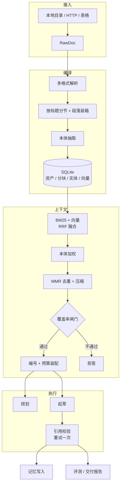

# fde-kit

**FDE 现场交付底座** —— 本体先行的知识编译、可解释的上下文装配、可验收的问答 Agent。


> Forward Deployed Engineer 的活儿不是“搭个 RAG demo”，而是：把客户现场那堆格式混乱的资料变成可检索的证据，
> 让每个回答都能指着出处说话，再用一份客户能签字的报告证明它到底行不行。

```bash
pip install -e ".[docs]"
fde compile --reset && fde ask "A100 的整机保修期是多久？" && fde eval && fde report
```

**不需要 API key。** 没有配置模型时自动进入离线模式：Hash-ngram 向量 + BM25 混合检索 + 抽取式作答，
整条链路（编译 → 检索 → 上下文装配 → 回答 → 评测 → 报告）照样跑通。配了模型就自动切换成生成式回答。

---

## 它和普通 RAG demo 的三个分水岭

**1. 本体先行，而不是上来就 embedding。**
`ontology/*.yaml` 里先写清楚这个现场有哪些实体（型号、故障码、备件号、序列号、政策口径、工单号），
它在编译期是抽取器，在检索期是加权器，在交付期是覆盖率验收口径。换客户时改这个文件，比调参数值钱。

**2. 上下文是一个被预算约束的装配过程，不是 top-k 拼接。**
近重复去重 → 句子级压缩 → 显式编号 `[S1]` → token 预算截断 → 注入会话记忆。
超预算就丢弃并记录，绝不悄悄截断；每个 `[S]` 都能回溯到具体文档的具体章节。

**3. 没有证据就拒答，而且这个决定可测。**
用 IDF 加权的**查询覆盖率**做闸门：库里没有的字词没被覆盖，且向量相似度也低，就直接说“没有找到”，
而不是拿三段弱相关文字拼一个看起来很专业的答案。评测集里专门放了一条反例题来守住这条线。

---

## 实测数字（示例语料，8 条用例，离线模式）

```
hit@5        100.0%   （纯词法基线 100.0%）
MRR           0.854    （纯词法基线 0.844）
关键词覆盖     100.0%
引用有效率     100.0%
有据可依率      87.5%   （唯一未命中是反例题：正确拒答）
平均延迟        6 ms
```

说句实话：**这组数字不能证明混合检索更强**。示例语料只有 6 份文档 24 个分块，
两个 must_cite 模式在 top-5 里几乎必然命中，天花板效应明显。
这套评测的价值在于**机制**：它会在你自己的语料上给出真实的 hit/MRR/覆盖/引用有效性，
并且永远带着纯 BM25 基线跑，让你知道向量那一路到底有没有在干活。
换到真实客户语料（几百上千份文档）时，这个差距才会显形。

---

## 架构



四个节点（plan → retrieve → draft → verify）写成纯函数，串行引擎和 LangGraph 引擎共用同一套逻辑，
不存在“图版本和脚本版本行为不一致”的经典坑。

---

## 五个命令

| 命令 | 干什么 |
|---|---|
| `fde compile --reset` | 全量编译资料，输出新增/跳过/失败、分块数、实体数 |
| `fde search "E021" -k 5` | 只看检索：BM25 / 向量 / RRF / 本体加权四个分数都摊开 |
| `fde ask "..." --trace` | 带引用的回答，`--trace` 看每步决策，`--json` 给机器读 |
| `fde eval` | 跑 `evals/golden.yaml`，自动带纯 BM25 基线对照 |
| `fde report` | 生成 markdown + html 交付验收报告 |

外加 `fde serve`（工作台）、`fde mcp`（stdio MCP 服务）、`fde stats`、`fde init`。

---

## 工作台

```bash
fde serve --port 8000   # 打开 http://127.0.0.1:8000
```

三栏：左边语料与本体覆盖，中间带引用的问答（SSE 流式），右边**上下文包**——
本次到底喂了哪几段、各自得分多少、token 预算用了多少、有哪些被丢弃。
点回答里的 `[S3]`，右栏对应证据会高亮。这一栏就是“可解释”三个字的落地。

顶栏可以直接跑评测（弹出 KPI 与逐条结果）和生成交付报告（新标签页打开 html）。

---

## 接进你已有的 agent（MCP）

```json
{
  "mcpServers": {
    "fde-kit": {
      "command": "fde",
      "args": ["mcp"],
      "cwd": "/path/to/fde-kit"
    }
  }
}
```

三个工具：`kb_search`（返回带分数的证据块）、`kb_ask`（带引用的回答）、`kb_stats`（规模与本体覆盖）。
Cursor / Claude Code / 客户自己的 agent 都能直接接，前端一行不用改。

---

## 换到你的客户现场

1. **写本体**：复制 `ontology/after_sales.yaml`，把实体类型、正则、别名换成你的领域。
2. **放资料**：`export FDE_CORPUS=/path/to/客户资料 && fde compile --reset`。
3. **写验收用例**：`evals/golden.yaml` 里每个必答口径配一条，再加一条“应该答不出”的反例。
4. **跑评测、出报告**：`fde eval && fde report`，把没通过的用例和编译 warnings 整理成《资料补充清单》。

第 4 步才是二次进场的抓手：客户看到的不是“你的模型不行”，而是“这 6 份文件没给我”。

---

## 目录结构

```
src/fde_kit/
├── ingest/        接入：本地目录、HTTP（connector 只负责拿数据）
├── compile/       编译：解析、切块、本体、编译管线
├── retrieve/      检索：BM25、向量、RRF、混合 + 本体加权
├── context/       上下文：装配、预算、压缩、会话记忆
├── llm/           模型：OpenAI 兼容客户端 + 提示词
├── agent/         执行：四节点 + LangGraph 适配
├── eval/          验收：指标、执行器
├── api/           HTTP + 单页工作台
├── report.py      交付报告
├── mcp_server.py  MCP stdio 服务
└── cli.py         命令行
```

运行时依赖只有 6 个：fastapi、uvicorn、httpx、numpy、PyYAML、pydantic。
PDF/DOCX/HTML 解析在 `[docs]` 附加依赖里，LangGraph 在 `[langchain]` 里。
核心链路不依赖 LangChain —— 这是刻意的：`framework-free core, thin adapters`。

---

## 已知限制（别被 README 骗了）

- **离线向量很朴素**：Hash-ngram 只是哈希投影，同义改写召回能力有限，靠 BM25 + 本体兜底。接真 embedding 后应该重跑评测。
- **扫描件 PDF 不支持**：没有文本层就跳过并在报告里列出，OCR/VLM 是明确的下一步。
- **表格只做行级文本化**：不解析合并单元格、不做跨表 join。结构化查询应该走 SQL，不该硬塞给 RAG。
- **单机 SQLite**：万级分块以内够用；再大要换 pgvector 或专用向量库，接口已经隔离在 `retrieve/` 里。
- **拒答阈值需要校准**：`FDE_MIN_COVERAGE`（默认 0.35）和 `FDE_MIN_VECTOR`（默认 0.32）是按示例语料调的，换语料要重测。
- **评测集只有 8 条**：够演示机制，不够证明效果。真实交付至少要 30～50 条，且必须包含反例。

---

## 与 jonex 的关系

架构上受 [yuezhiai/jonex](https://github.com/yuezhiai/jonex) 启发：知识流水线分层、RAG 原子能力与业务解耦、
MCP 暴露知识库、本体先行的知识编译。区别是 fde-kit 刻意**不做平台**——
没有多租户、没有 Milvus/Neo4j/etcd 全家桶、没有四套前端，
只保留一条能在一台笔记本上跑完、且能出交付报告的最小闭环。

如果你要的是企业级平台，去看 jonex；如果你要的是“明天去见客户，今晚能演示”，用这个。

## License

MIT
